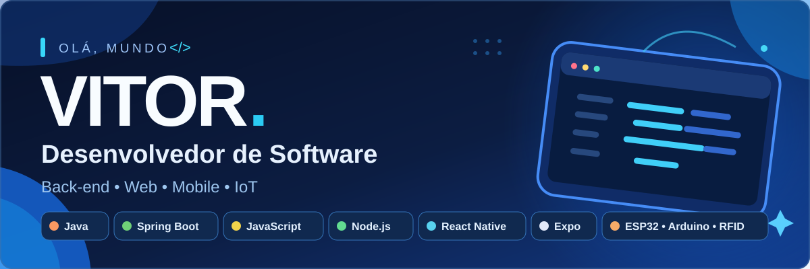

  

   

  ### Oi, eu sou o Vitor! 👋

  **Desenvolvedor em formação · Back-end · Web · Mobile · Hardware**

---

### 👨‍💻 Sobre mim

Estou em constante aprendizado e gosto de explorar diferentes áreas da tecnologia: desde o desenvolvimento de APIs e interfaces até aplicativos mobile e projetos físicos com microcontroladores.

- 💻 Desenvolvo com **Java, JavaScript, Node.js e Spring Boot**
- 📱 Crio aplicativos com **React Native e Expo**
- 🌐 Trabalho com **HTML, CSS** e desenvolvimento web
- 🗄️ Conheço **SQL e MySQL**
- 🔌 Também trabalho com **ESP32, Arduino e RFID**, integrando hardware e software
- 🚀 Busco evoluir com projetos práticos e boas práticas de desenvolvimento

### 🛠️ Tecnologias e ferramentas

  

    

  
  
  
  
  

 

<table align="center">
  <thead><tr><th align="center">Área</th><th align="center">Tecnologias</th></tr></thead>
  <tbody>
    <tr><td align="center"><strong>Back-end</strong></td><td align="center">Java, Spring Boot, Node.js, APIs REST</td></tr>
    <tr><td align="center"><strong>Web</strong></td><td align="center">JavaScript, HTML, CSS</td></tr>
    <tr><td align="center"><strong>Mobile</strong></td><td align="center">React Native, Expo</td></tr>
    <tr><td align="center"><strong>Banco de dados</strong></td><td align="center">SQL, MySQL</td></tr>
    <tr><td align="center"><strong>Hardware e IoT</strong></td><td align="center">ESP32, Arduino, RFID</td></tr>
  </tbody>
</table>

### 🔧 Software + Hardware

Gosto de desenvolver soluções que conectam o mundo digital ao físico, usando **microcontroladores**, **leitores RFID** e integração com aplicações e serviços.

---

  💙 Tecnologia, criatividade e aprendizado contínuo.

